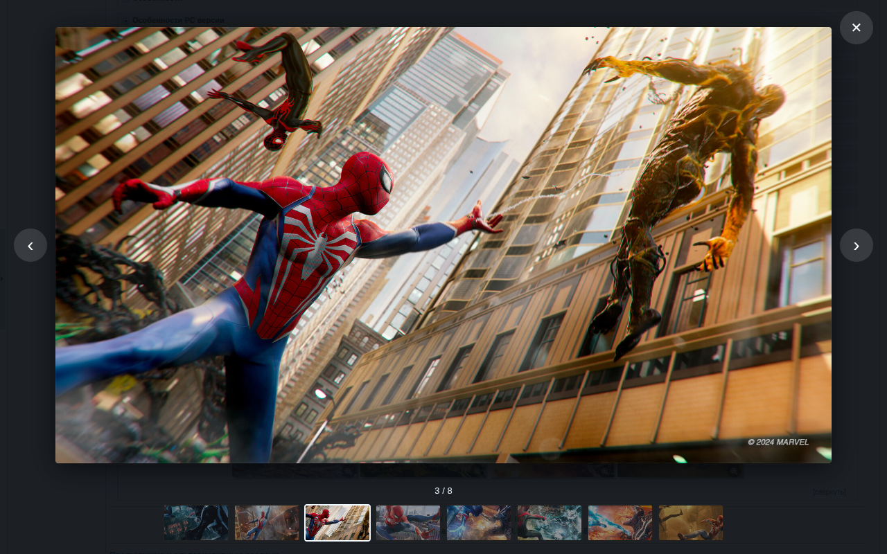

<h1 align="center">
  <br>
  RuTracker Games
</h1>

<p align="center">
  <a href="../../README.md">🇬🇧&nbsp;English</a> •
  <a href="README.uk.md">🇺🇦&nbsp;Українська</a> •
  <a href="README.ru.md">🇷🇺&nbsp;Русский</a> •
  <a href="README.de.md">🇩🇪&nbsp;Deutsch</a> •
  <a href="README.fr.md">🇫🇷&nbsp;Français</a> •
  <a href="README.es.md">🇪🇸&nbsp;Español</a> •
  <a href="README.it.md">🇮🇹&nbsp;Italiano</a> •
  <a href="README.pl.md">🇵🇱&nbsp;Polski</a> •
  <a href="README.pt.md">🇧🇷&nbsp;Português</a> •
  <a href="README.ja.md">🇯🇵&nbsp;日本語</a>
</p>

<h4 align="center">Screenshots und praktische Markierungen direkt in den Listen der Spiele-Releases auf RuTracker – ohne jedes Thema einzeln öffnen zu müssen.</h4>

<p align="center">
  <a href="../../LICENSE"></a>
  <a href="../../CHANGELOG.md"></a>
  
  
  <a href="https://github.com/iArtem88/rutracker-games/actions/workflows/ci.yml"></a>
</p>

<p align="center">
  
</p>

---

## Inhalt

- [Was die Erweiterung kann](#was-die-erweiterung-kann)
- [Unterstützte Bereiche](#unterstützte-bereiche)
- [Installation](#installation)
- [Bedienung](#bedienung)
- [Die Markierungen im Detail](#die-markierungen-im-detail)
- [Eigene Markierungen und Wörter](#eigene-markierungen-und-wörter)
- [Datenschutz](#datenschutz)
- [Rücksicht auf die Website](#rücksicht-auf-die-website)
- [Häufige Fragen](#häufige-fragen)
- [Mitmachen](#mitmachen)
- [Entwicklung](#entwicklung)
- [Lizenz](#lizenz)

## Was die Erweiterung kann

Direkt in der Release-Liste, zwischen Titel und Autor:

- **Screenshots** aus dem Spoiler „Скриншоты“ des Releases: dieselben Vorschaubilder wie im Thema. Eines mit Lupe öffnet sich in voller Größe im eigenen Bildbetrachter der Erweiterung, direkt auf der Seite und ohne die Werbung des Bildhosters: ← → oder der Streifen mit Vorschaubildern darunter blättern, Esc schließt. Ohne Lupe ist es nur ein Bild: Auf die Seiten der Bildhoster verlinkt die Erweiterung nicht. Angezeigt wird eine Reihe, „N weitere“ klappt den Rest auf.
- **Im Thema eines Releases** klappen die Spoiler mit Screenshots von selbst auf (das lässt sich in den Einstellungen abschalten), und die Screenshots öffnen sich im selben Bildbetrachter.
- **Markierungen aus der Release-Beschreibung:**
  -  – Sprachausgabe in deiner Sprache, mit Details in Klammern: maschinell, Fan-Version, teilweise, Mod;
  -  – das Spiel ist in deiner Sprache und hat schlicht keine Sprachausgabe;
  -  – Text und Untertitel in deiner Sprache, Sprachausgabe in einer anderen;
  -  – ob eine Switch übertaktet werden muss und ob das in Kefir eingebaute Übertakten dafür reicht;
  -  – die PS4-/PS5-Firmware, auf der das Spiel läuft;
  -  – der Mindest-RAM und die Mindest-Grafikkarte für den PC;
  -  – laut Systemanforderungen sollte das Spiel auf dem Steam Deck laufen, und  ist die offizielle Bewertung von Valve (in den Einstellungen einschalten).
- **Eine Filterleiste** über der Liste: „Sprachausgabe in meinen Sprachen“, „In meinen Sprachen“, „Läuft auf meiner Switch“, „Läuft auf meiner Firmware“, „Genug RAM in meinem PC“, „Läuft auf dem Steam Deck“ und deine eigenen Markierungen.
- **Deine Sprachen.** Markierungen für Sprachausgabe und Text erscheinen für die Sprachen, die du unter „Meine Sprachen“ anhakst: Englisch, Ukrainisch, Russisch, Deutsch, Französisch, Spanisch, Italienisch, Polnisch, Portugiesisch, Japanisch. Russisch, Ukrainisch und die Sprache der Oberfläche sind standardmäßig angehakt. Auch die Oberfläche der Erweiterung gibt es in diesen 10 Sprachen.
- **Eigene Markierungen** nach Wörtern oder einem regulären Ausdruck und **eigene Wörter** für die Markierung zum Übertakten der Switch.

<p align="center">
  
</p>

## Unterstützte Bereiche

Die Erweiterung funktioniert in den Listen der Spielebereiche von RuTracker, in deren Suchergebnissen und in den Themen der Releases:

| Bereich | Was angezeigt wird |
|---|---|
| Spiele für Konsolen » Switch | Screenshots, Sprachen, Übertakten (Kefir / 4IFIR) |
| Spiele für Konsolen » PS4, PS5 | Screenshots, Sprachen, benötigte Firmware |
| Andere Konsolen (PS1–PS3, PSP, Vita, Xbox, Wii, DS, Dreamcast…) | Screenshots, Sprachen |
| Spiele für Windows | Screenshots, Sprachen, Mindest-RAM und Grafikkarte, Steam Deck |
| Spiele für Mac, Spiele für Linux | Screenshots, Sprachen |
| Spiele für Mobilgeräte (Android, Oculus Quest, Symbian, Windows Mobile) | Screenshots, Sprachen |
| Erweiterungen: Mods und Übersetzungen für Windows-Spiele, Train Simulator, Flugsimulatoren | Screenshots, Sprachen |

Filme, Musik und alles Übrige bleiben bewusst außen vor: Dafür sind eigene Erweiterungen besser, damit jede für sich einfach bleibt. In allen anderen Bereichen des Forums tut die Erweiterung nichts und sendet keine Anfragen.

<p align="center">
  
  
</p>

## Installation

- **Chrome, Edge, Brave, Opera, Yandex Browser:** Lade `rutracker-games-…-chrome-full.zip` unter [Releases](https://github.com/iArtem88/rutracker-games/releases) herunter und entpacke die Datei. Öffne `chrome://extensions`, aktiviere den „Entwicklermodus“ und klicke auf „Entpackte Erweiterung laden“. Das ist die volle Version; `…-chrome.zip` daneben ist die des Chrome Web Store, in der die geschützten fastpic-Screenshots (Dateien `_…`) Vorschaubilder bleiben.
- **Firefox:** Lade `rutracker-games-…-firefox.xpi` unter [Releases](https://github.com/iArtem88/rutracker-games/releases) herunter und öffne die Datei in Firefox (oder ziehe sie ins Fenster), dann klicke auf „Hinzufügen“. Sie ist von Mozilla signiert, die Erweiterung aktualisiert sich selbst.

## Bedienung

Einrichten musst du nichts: Öffne einen Spielebereich, etwa [Switch](https://rutracker.org/forum/viewforum.php?f=1605), und schon funktioniert alles.

- **Die Schaltfläche der Erweiterung** in der Symbolleiste des Browsers schaltet die Erweiterung und ihre Markierungen ein und aus und legt die Größe der Vorschaubilder fest.
- **Alle Einstellungen** („Eigene Markierungen und alle Einstellungen“ in diesem Fenster oder „⚙ Einstellungen“ auf der Filterleiste): deine Sprachen, deine Switch, deine PS-Firmware, der RAM deines PCs, Steam Deck, eigene Markierungen und Wörter, der Cache.
- **Fahr mit der Maus über eine Markierung**, um die Zeile aus dem Release zu sehen, auf der sie beruht.
- **Aussehen:** Der gleichnamige Tab legt Textfarbe, Hintergrund und Rahmen jeder Markierung fest, auch die der eigenen. Änderungen wirken sofort, auch in offenen RuTracker-Tabs.

<p align="center">
  
  
</p>

## Die Markierungen im Detail

### Sprachausgabe

Zum Beispiel „Sprachausgabe: Russisch“ oder „Sprachausgabe: Ukrainisch“. Entnommen aus der Zeile „Озвучка:“ oder „Язык озвучки:“ („русская, английская“, „ENG+RUS“); fehlt sie, aus der Beschreibung („опциональная русская озвучка…“, „Russian Voice Mod“) und aus dem Titel („RUS (Voice Mod.)“, „RUS sound“). Formulierungen wie „русской озвучки не будет“ setzen keine Markierung.

### Text

Zum Beispiel „Text: Russisch“. Wird gesetzt, wenn die Sprache in der Zeile „Язык интерфейса“ steht, es aber keine Sprachausgabe in dieser Sprache gibt:

- grün „(ohne Sprachausgabe)“ – das Spiel hat keine Sprachausgabe und ist vollständig in deiner Sprache;
- gelb „(Sprachausgabe: Englisch)“ – Text und Untertitel in deiner Sprache, die Sprachausgabe in der Sprache in Klammern;
- nur umrandet, ohne Klammern – das Release verrät nicht, ob es eine Sprachausgabe gibt.

### Sprachfilter

„In meinen Sprachen“ und „Sprachausgabe in meinen Sprachen“ sind eine Auswahl: Drückst du einen, springt der andere heraus; drückst du ihn noch einmal, wird wieder alles angezeigt. Die übrigen Filter kommen dazu.

| Release | Alle (nichts gedrückt) | In meinen Sprachen | Sprachausgabe in meinen Sprachen |
|---|:-:|:-:|:-:|
| Sprachausgabe: Russisch | ✅ | ✅ | ✅ |
| Text: Russisch (ohne Sprachausgabe) | ✅ | ✅ | ✅ |
| Text: Russisch (Sprachausgabe: Englisch) | ✅ | ✅ | ❌ |
| „Text: Russisch“ – das Release sagt nichts zur Sprachausgabe | ✅ | ✅ | ❌ |
| Nichts auf Russisch | ✅ | ❌ | ❌ |

### Übertakten der Switch

Die Erweiterung prüft, ob der Uploader dazu auffordert, die Konsole zu übertakten, und welche Taktraten er angibt, und vergleicht sie mit dem, was das in Kefir eingebaute Übertakten erreicht:

| Revision | CPU | GPU | RAM |
|---|---|---|---|
| Mariko (V2, Lite, OLED) | 1963 MHz | 1267 MHz | 2131 MHz |
| Erista (V1) | 1785 MHz | 921 MHz | 1862 MHz |

Die Markierung besteht aus zwei Hälften:

- **„empfohlen“ oder „nötig“** – je nachdem, wie der Uploader es formuliert: „лучше“, „рекомендуется“, „желательно“ bzw. „обязательно“, „нужен“, „требуется“. Steht beides da („стоит обязательно разогнать“), gilt es als nötig.
- **Kefir oder 4IFIR („Чифир“)** – wie viel verlangt wird. 4IFIR, wenn der Uploader es nennt (aber nicht bei „работает и без Чифира“), Taktraten über den Grenzen von Kefir angibt oder „максимальный“ Übertakten verlangt (außer „максимальный разгон Кефира“). Sonst Kefir.

| Der Uploader schreibt | Markierung |
|---|---|
| „Лучше всего использовать разгон консоли“ | Übertakten empfohlen: Kefir |
| „Лучше всего максимально разогнать консоль“ | Übertakten empfohlen: 4IFIR |
| „Обязательно нужен разгон“ | Übertakten nötig: Kefir |
| „Обязательно нужен разгон, CPU 2397 МГц“ | Übertakten nötig: 4IFIR |

„Nötig“ ist ausgefüllt, „empfohlen“ nur umrandet. Gib in den Einstellungen die Revision deiner Konsole und dein Übertakten an: Ein Release, das mehr verlangt, als deine Switch schafft, bekommt ein ⚠, und der Filter „Läuft auf meiner Switch“ blendet es aus.

Woher die Grenzwerte stammen: aus den Quellen von Kefir selbst. Dessen `kefir.kip` hebt die Taktraten auf Mariko auf bis zu CPU 2193 / GPU 1267 / RAM 2131 MHz an, und sein sys-clk hält die CPU auf den sicheren 1963 (Mariko) bzw. 1785 (Erista), solange `allow_unsafe_freq` nicht von Hand gesetzt ist.

### PS4-/PS5-Firmware

Aus der Zeile „Минимальная версия прошивки“. Backports werden berücksichtigt („8.50 + BACKPORT [5.05…]“ heißt: läuft ab 5.05), ebenso eine Obergrenze („работает только до 11.60“). Gib deine Firmware in den Einstellungen an, dann bekommen Releases, die darauf nicht laufen, ein ⚠.

### PC: RAM und Grafikkarte

Der Mindest-RAM und die erste Grafikkarte aus den Systemanforderungen; der Tooltip zeigt alle Angaben: Betriebssystem, CPU, Grafikkarte. Gib den RAM deines PCs in den Einstellungen an, dann bekommen Releases, die mehr verlangen, ein ⚠.

**Sammlungen.** Enthält ein Release mehrere Spiele, jedes in einem eigenen Spoiler mit eigenen Anforderungen (Anthologien), zeigt die Markierung die Spanne und die anspruchsvollste Grafikkarte, z. B. „1–6 GB RAM · bis GTX 780“, und der Tooltip listet jedes Spiel auf. Die Filter und die Steam-Deck-Einschätzung richten sich nach dem anspruchsvollsten Spiel.

### Steam Deck

Zwei Bewertungen:

- **Nach den Systemanforderungen** (standardmäßig an): das violette „Läuft auf dem Steam Deck“. Grafisch entspricht das Steam Deck etwa einer GTX 1050 Ti, spielt aber in 800p und schafft deshalb Mindestanforderungen bis etwa GTX 1060 / RX 580 und 16 GB RAM. CPU und Proton-Kompatibilität werden nicht berücksichtigt.
- **Die offizielle Bewertung von Valve** (standardmäßig aus; beim Einschalten bittet der Browser um Zugriff auf die Steam-Website): „verifiziert“ (läuft vollständig), „spielbar“ (braucht eventuell Anpassungen), „nicht unterstützt“. Das Spiel wird über den Steam- oder SteamDB-Link im Release gefunden, sonst über einen exakt übereinstimmenden Titel bei Steam. Wo es Valves Bewertung gibt, hat sie Vorrang. Sie gilt für die Steam-Version: Der Build im Release kann davon abweichen. Sammlungen bekommen sie nicht.

## Eigene Markierungen und Wörter

**Eigene Markierungen.** Füge in den Einstellungen Wörter wie `DLC|дополнения` oder `кооператив` hinzu oder einen regulären Ausdruck zwischen Schrägstrichen wie `/(лучше|рекомендуется|желательно).*разгон/`. Releases, deren Titel oder Beschreibung darauf passt, bekommen deine Markierung in der Farbe deiner Wahl, und du kannst sie auf die Filterleiste setzen. Ein paar Beispiele bringt die Erweiterung schon mit, ausgeschaltet.

<p align="center">
  
</p>

**Eigene Wörter fürs Übertakten der Switch.** In den Switch-Einstellungen zeigt „Eigene Wörter für die Markierungen“ die Wörter, nach denen sich die Markierung zum Übertakten richtet – zum Übertakten selbst, „empfohlen“, „nötig“, „nicht nötig“, „maximal“, die Namen von 4IFIR und Kefir –, und dort kannst du eigene hinzufügen. Sie ergänzen die eingebauten und wirken sofort, auch bei bereits geladenen Releases.

<p align="center">
  
</p>

## Datenschutz

- Keine Werbung, keine Analyse, keine Konten, keine eigenen Server.
- Die Erweiterung ruft nur Seiten von RuTracker selbst ab, so als würdest du das Thema selbst öffnen, und lädt Bilder von denselben Bildhostern, die das Thema verwendet. Die einzige Ausnahme ist die Steam-Deck-Bewertung von Valve: Wenn du sie einschaltest, fragt die Erweiterung bei Steam die ID und die Bewertung des Spiels ab (ohne deine Cookies oder Daten). In der vollen Version lädt der Bildbetrachter bei fastpic-Bildern, die der Hoster nur über seine eigene Seite herausgibt, diese Seite unsichtbar und mit abgeschalteten Skripten und nimmt von dort den Link zum Bild; die Version aus dem Chrome Web Store lädt keine fastpic-Seiten. Bei Bildern von ImgBB und PostImages liest sie die Adresse des vollen Bildes von dessen Seite beim Hoster ab (ohne deine Cookies).
- Die Einstellungen und der Cache der Release-Beschreibungen bleiben in deinem Browser.
- Der Code ist offen, jeder kann ihn prüfen. Mehr dazu in [PRIVACY.md](../../PRIVACY.md).

## Rücksicht auf die Website

- Die Erweiterung lädt nur die Releases, zu denen du scrollst, mit höchstens 2 Anfragen gleichzeitig und mit Pausen dazwischen.
- Ist die Website ausgelastet oder begrenzt sie Anfragen (429, 5xx, 403 von Cloudflare), hält sich die Erweiterung eine Weile zurück und macht dann weiter.
- Die Beschreibung eines Releases wird einmal geladen und einen Monat lang aufbewahrt; erneut geladen wird sie nur, wenn das Release aktualisiert wird (sich also sein Titel oder seine Größe in der Liste ändert). Updates der Erweiterung leeren den Cache nicht: Er speichert die Beschreibung selbst und wertet sie neu aus.
- Ein aktiver Filter prüft gleich die ganze Seite. Um nur das zu laden, wohin du scrollst, schalte in den Einstellungen „Ein Filter prüft gleich die ganze Seite“ aus.

## Häufige Fragen

**Graue Kästen statt Screenshots.** Das Bild kommt von einem Bildhoster (fastpic, imageban…), der in deinem Netz langsam oder gesperrt ist. Solche Platzhalter verschwinden nach 20 Sekunden.

**Eine Markierung fehlt oder dürfte gar nicht da sein.** Release-Beschreibungen schreiben Menschen, und jeder schreibt sie auf seine Weise. Fahr mit der Maus über die Markierung, um zu sehen, worauf sie beruht. Ist sie falsch, [eröffne ein Issue](https://github.com/iArtem88/rutracker-games/issues) mit einem Link zum Release, und wir verbessern die Auswertung. Beim Übertakten der Switch kannst du außerdem gleich eigene Wörter hinzufügen.

**Warum keine Filme?** Die Erweiterung dreht sich um Spiele. Andere Inhalte verdienen eine eigene Erweiterung: So bleibt jede einfach.

**Ist sie offiziell?** Nein. Es ist ein unabhängiges Projekt ohne Verbindung zu RuTracker.

## Mitmachen

Einen Fehler gefunden oder soll ein weiterer Bereich unterstützt werden? Sieh dir [CONTRIBUTING.md](../../CONTRIBUTING.md) an (auf Russisch): Ein neuer Bereich ist eine einzige kleine Datei, und Issues sind in jeder Sprache willkommen.

## Entwicklung

```sh
npm install        # nur für die Tests und den Build; nichts davon landet in der Erweiterung
npm test           # die Parsing-Tests, in echtem Chromium
npm run test:e2e   # die ganze Erweiterung in Google Chrome gegen ein nachgebautes RuTracker, etwa eine Minute
npm run build      # dist/rutracker-games-<version>-chrome.zip und …-firefox.zip
```

Die Erweiterung selbst ist reines JavaScript ohne Build-Schritt: Lade `src/` als entpackte Erweiterung, um deine Änderungen auszuprobieren.

## Lizenz

Copyright © 2026 [iArtem88](https://github.com/iArtem88).

RuTracker Games ist freie Software unter der [GNU General Public License v3.0](../../LICENSE) oder (nach deiner Wahl) jeder späteren Version: Du darfst sie nutzen, verändern und weitergeben, und jede Kopie und jede veränderte Fassung muss ebenfalls unter der GPL offen bleiben.

Dies ist eine inoffizielle Erweiterung ohne Verbindung zu RuTracker.
