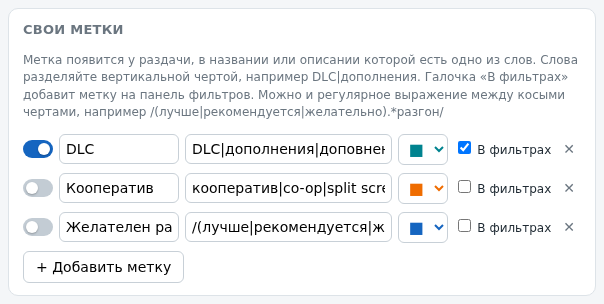

<h1 align="center">
  <br>
  RuTracker Games
</h1>

<p align="center">
  <a href="../../README.md">🇬🇧&nbsp;English</a> •
  <a href="README.uk.md">🇺🇦&nbsp;Українська</a> •
  <a href="README.ru.md">🇷🇺&nbsp;Русский</a> •
  <a href="README.de.md">🇩🇪&nbsp;Deutsch</a> •
  <a href="README.fr.md">🇫🇷&nbsp;Français</a> •
  <a href="README.es.md">🇪🇸&nbsp;Español</a> •
  <a href="README.it.md">🇮🇹&nbsp;Italiano</a> •
  <a href="README.pl.md">🇵🇱&nbsp;Polski</a> •
  <a href="README.pt.md">🇧🇷&nbsp;Português</a> •
  <a href="README.ja.md">🇯🇵&nbsp;日本語</a>
</p>

<h4 align="center">RuTrackerのゲーム配布一覧に、スクリーンショットと便利なラベルをそのまま表示します。トピックをひとつずつ開く必要はありません。</h4>

<p align="center">
  <a href="../../LICENSE"></a>
  <a href="../../CHANGELOG.md"></a>
  
  
  <a href="https://github.com/iArtem88/rutracker-games/actions/workflows/ci.yml"></a>
</p>

<p align="center">
  
</p>

---

## 目次

- [できること](#できること)
- [対応区分](#対応区分)
- [インストール](#インストール)
- [使い方](#使い方)
- [ラベルの詳細](#ラベルの詳細)
- [自分のラベルと単語](#自分のラベルと単語)
- [プライバシー](#プライバシー)
- [サイトへの配慮](#サイトへの配慮)
- [よくある質問](#よくある質問)
- [コントリビューション](#コントリビューション)
- [開発](#開発)
- [ライセンス](#ライセンス)

## できること

配布一覧のタイトルと投稿者のあいだに、次のものを表示します。

- **スクリーンショット**：配布の「Скриншоты」スポイラーから取得します。トピックと同じサムネイルです。虫眼鏡の付いたものは、拡張機能のビューアーでページ上にそのまま元の大きさで開き、画像ホスティングの広告は表示されません。← → または下のサムネイル列で切り替え、Escで閉じます。虫眼鏡のないものは、クリックすると画像ホスティングのページが開きます。最初は1列だけ表示され、「あとN枚」で残りを展開できます。
- **配布のトピック**では、スクリーンショットのスポイラーが自動で開き（設定でオフにできます）、スクリーンショットは同じビューアーで開きます。
- **配布の説明から読み取ったラベル：**
  -  — 自分の言語の音声です。かっこ内に詳細（機械音声、有志、一部、MOD）が付きます。
  -  — ゲームが自分の言語に対応していて、もともと音声がありません。
  -  — テキストと字幕は自分の言語、音声は別の言語です。
  -  — Switchでオーバークロックが必要か、Kefir標準のオーバークロックで足りるかを示します。
  -  — ゲームが動くPS4 / PS5のファームウェアです。
  -  — PCの最低RAMとグラフィックカードです。
  -  — 動作環境から見て、Steam Deckで動くはずのゲームです。 はValveの公式評価です（設定でオンにします）。
- **フィルターバー**：一覧の上に「自分の言語の音声」「自分の言語あり」「自分のSwitchで動く」「自分のファームウェアで動く」「自分のPCのRAMで足りる」「Steam Deckで動く」と、自分で作ったラベルが並びます。
- **自分の言語**：音声とテキストのラベルは、「自分の言語」でチェックした言語について表示されます。選べるのは英語、ウクライナ語、ロシア語、ドイツ語、フランス語、スペイン語、イタリア語、ポーランド語、ポルトガル語、日本語です。ロシア語、ウクライナ語、表示言語は最初からチェックされています。拡張機能の画面もこの10言語に対応しています。
- **自分のラベル**を単語や正規表現で作れます。Switchのオーバークロックのラベルには**独自の単語**も追加できます。

## 対応区分

この拡張機能は、RuTrackerのゲーム区分の一覧、検索結果、配布のトピックで動作します。

| 区分 | 表示する内容 |
|---|---|
| ゲーム機用ゲーム » Switch | スクリーンショット、言語、オーバークロック（Kefir / 4IFIR） |
| ゲーム機用ゲーム » PS4、PS5 | スクリーンショット、言語、必要なファームウェア |
| その他のゲーム機（PS1–PS3、PSP、Vita、Xbox、Wii、DS、Dreamcast…） | スクリーンショット、言語 |
| Windows用ゲーム | スクリーンショット、言語、最低RAMとグラフィックカード、Steam Deck |
| Mac用ゲーム、Linux用ゲーム | スクリーンショット、言語 |
| モバイル端末用ゲーム（Android、Oculus Quest、Symbian、Windows Mobile） | スクリーンショット、言語 |
| 追加コンテンツ：Windowsゲーム用MODと翻訳、Train Simulator、フライトシミュレーター | スクリーンショット、言語 |

映画や音楽などは、あえて対象外にしています。それぞれをシンプルに保つため、別の拡張機能にしたほうがよいと考えているからです。

<p align="center">
  
  
</p>

## インストール

- **Chrome、Edge、Brave、Opera、Yandex Browser：** [Releases](https://github.com/iArtem88/rutracker-games/releases) から `rutracker-games-…-chrome.zip` をダウンロードして展開します。`chrome://extensions` を開き、「デベロッパー モード」をオンにして「パッケージ化されていない拡張機能を読み込む」をクリックします。

## 使い方

設定は不要です。ゲームの区分（たとえば[Switch](https://rutracker.org/forum/viewforum.php?f=1605)）を開けば、すぐに動作します。

- **拡張機能のボタン**（ブラウザーのツールバー）で、拡張機能とラベルのオン・オフを切り替え、サムネイルの大きさを設定できます。
- **すべての設定**（そのウィンドウの「自分のラベルとすべての設定」、またはフィルターバーの「⚙ 設定」）：自分の言語、Switch、PSのファームウェア、PCのRAM、Steam Deck、自分のラベルと単語、キャッシュ。
- **ラベルにマウスを重ねる**と、その根拠になった配布の行が表示されます。
- **外観**：「外観」タブでは、自分で作ったものも含め、すべてのラベルの文字色、背景色、枠の色を設定できます。変更はすぐに、開いているRuTrackerのタブにも反映されます。

<p align="center">
  
  
</p>

## ラベルの詳細

### 音声

例：「ロシア語音声」「ウクライナ語音声」。«Озвучка:» または «Язык озвучки:» の行（«русская, английская»、«ENG+RUS»）から読み取ります。その行がなければ、説明文（«опциональная русская озвучка…»、«Russian Voice Mod»）やタイトル（«RUS (Voice Mod.)»、«RUS sound»）から判断します。«русской озвучки не будет» のような表現ではラベルは付きません。

### テキスト

例：「ロシア語テキスト」。言語が «Язык интерфейса» の行にあるものの、その言語の音声がない場合に付きます。

- 緑の「(音声なし)」：ゲームに音声がなく、すべて自分の言語で遊べます。
- 黄色の「(英語音声)」：テキストと字幕は自分の言語で、音声はかっこ内の言語です。
- 枠線だけでかっこなし：音声があるかどうかが配布に書かれていません。

### 言語フィルター

「自分の言語あり」と「自分の言語の音声」はどちらか一方を選ぶ形式です。片方を押すともう片方は解除され、同じボタンをもう一度押すとすべて表示されます。ほかのフィルターとは組み合わせて使えます。

| 配布 | すべて（何も押していない） | 自分の言語あり | 自分の言語の音声 |
|---|:-:|:-:|:-:|
| ロシア語音声 | ✅ | ✅ | ✅ |
| ロシア語テキスト (音声なし) | ✅ | ✅ | ✅ |
| ロシア語テキスト (英語音声) | ✅ | ✅ | ❌ |
| 「ロシア語テキスト」— 配布に音声の記載なし | ✅ | ✅ | ❌ |
| ロシア語なし | ✅ | ❌ | ❌ |

### Switchのオーバークロック

この拡張機能は、投稿者が本体のオーバークロックを求めているか、どのクロックを挙げているかを調べ、Kefir標準のオーバークロックで届く値と比べます。

| リビジョン | CPU | GPU | RAM |
|---|---|---|---|
| Mariko（V2、Lite、有機EL） | 1963 MHz | 1267 MHz | 2131 MHz |
| Erista（V1） | 1785 MHz | 921 MHz | 1862 MHz |

ラベルは2つの部分からなります。

- **「推奨」か「必須」か**：投稿者の書き方に従います（«лучше»、«рекомендуется»、«желательно» か、«обязательно»、«нужен»、«требуется» か）。両方ある場合（«стоит обязательно разогнать»）は「必須」になります。
- **Kefirか4IFIR（«Чифир»）か**：どの程度のオーバークロックを求めているかです。4IFIRの名前が挙がっている場合（ただし «работает и без Чифира» は除く）、Kefirの上限を超えるクロックが書かれている場合、«максимальный» オーバークロックを求めている場合（«максимальный разгон Кефира» は除く）は4IFIRになります。それ以外はKefirです。

| 投稿者の記述 | ラベル |
|---|---|
| «Лучше всего использовать разгон консоли» | オーバークロック推奨: Kefir |
| «Лучше всего максимально разогнать консоль» | オーバークロック推奨: 4IFIR |
| «Обязательно нужен разгон» | オーバークロック必須: Kefir |
| «Обязательно нужен разгон, CPU 2397 МГц» | オーバークロック必須: 4IFIR |

「必須」は塗りつぶし、「推奨」は枠線だけで表示されます。設定で本体のリビジョンとオーバークロックを指定すると、それ以上を求める配布には⚠が付き、「自分のSwitchで動く」フィルターで非表示になります。

上限値の出典は、Kefir自身のソースコードです。Kefirの `kefir.kip` はMarikoでクロックをCPU 2193 / GPU 1267 / RAM 2131 MHzまで引き上げます。また、Kefirのsys-clkは、`allow_unsafe_freq` を手動で設定しない限り、CPUを安全な1963（Mariko）と1785（Erista）に抑えます。

### PS4 / PS5のファームウェア

«Минимальная версия прошивки» の行から読み取ります。バックポート（«8.50 + BACKPORT [5.05…]» は5.05以上で動くという意味です）や、上限（«работает только до 11.60»）も考慮します。設定で自分のファームウェアを指定すると、動かない配布には⚠が付きます。

### PCのRAMとグラフィックカード

動作環境のうち、最低RAMと最初に挙がっているグラフィックカードを表示します。ツールチップには、OS、CPU、グラフィックカードなど、すべての項目が表示されます。設定でPCのRAMを指定すると、それより多くを求める配布には⚠が付きます。

**コレクション：** 1つの配布に複数のゲームが含まれ、それぞれのスポイラーに個別の動作環境が書かれている場合（アンソロジーなど）、ラベルには範囲と最も要求の高いグラフィックカードを表示し（例：「RAM 1–6 GB · 最大 GTX 780」）、ツールチップにはすべてのゲームを一覧表示します。フィルターとSteam Deckの推定は、最も重いゲームを基準にします。

### Steam Deck

評価は2種類あります。

- **動作環境による推定**（初期設定でオン）：紫の「Steam Deckで動く」です。Steam DeckのグラフィックはGTX 1050 Ti程度ですが、800pで動作するため、最低動作環境がGTX 1060 / RX 580程度、RAM 16 GBまでなら対応できます。CPUとProtonの互換性は考慮していません。
- **Valveの公式評価**（初期設定でオフ。オンにすると、ブラウザーがSteamのサイトへのアクセス許可を求めます）：「確認済み」（完全に動作）、「プレイ可能」（調整が必要な場合あり）、「非対応」の3つです。ゲームは配布内のSteamまたはSteamDBのリンクから、なければSteamでのタイトルの完全一致で特定します。Valveの評価がある場合は、そちらが優先されます。評価はSteam版に対するもので、配布のビルドとは異なる場合があります。コレクションには付きません。

## 自分のラベルと単語

**自分のラベル：** 設定で `DLC|дополнения` や `кооператив` のような単語、または `/(лучше|рекомендуется|желательно).*разгон/` のようにスラッシュで囲んだ正規表現を追加します。タイトルか説明が一致した配布に、選んだ色でそのラベルが付きます。ラベルはフィルターバーに置くこともできます。いくつかの例が、オフの状態で最初から用意されています。

<p align="center">
  
</p>

**Switchのオーバークロック用の独自の単語：** Switchの設定の下にある「ラベル用の独自の単語」では、オーバークロックのラベルが判定に使う単語（オーバークロックを表す単語、「推奨」「必須」「不要」「最大」、4IFIRとKefirの名前）を確認し、自分の単語を追加できます。追加した単語は組み込みの単語と合わせて使われ、すでに読み込まれた配布にもすぐに反映されます。

<p align="center">
  
</p>

## プライバシー

- 広告、アクセス解析、アカウント、独自のサーバーは一切ありません。
- リクエストするのはRuTracker自体のページだけで、自分でトピックを開いたときと変わりません。画像も、トピックが使っているのと同じ画像ホスティングから読み込みます。唯一の例外はValveのSteam Deck評価です。これをオンにすると、拡張機能はSteamにゲームのIDと評価を問い合わせます（あなたのCookieやデータは送りません）。fastpicが自分のページ経由でしか渡さない画像については、ビューアーがそのページを見えない状態で、スクリプトと広告を無効にして開き、そこから画像へのリンクを取得します。自分でサムネイルをクリックしたときと同じです。ImgBBとPostImagesの画像については、ホスティングのページから元の画像のアドレスを読み取ります（あなたのCookieは送りません）。
- 設定と配布の説明のキャッシュは、ブラウザー内に保存されます。
- コードは公開されており、誰でも確認できます。詳しくは[PRIVACY.md](../../PRIVACY.md)をご覧ください。

## サイトへの配慮

- 読み込むのはスクロールして近づいた配布だけで、同時リクエストは最大2件、間には休止を挟みます。
- サイトが混雑しているときやリクエストを制限しているとき（429、5xx、Cloudflareの403）は、しばらく待ってから再開します。
- 配布の説明は一度読み込むと1か月間保存されます。再び読み込むのは、配布が更新されたとき（一覧でタイトルやサイズが変わったとき）だけです。拡張機能を更新してもキャッシュは消えません。キャッシュには説明そのものが保存されているので、それを読み直します。
- フィルターが有効なときは、ページ全体をまとめて確認します。スクロールした分だけを読み込みたい場合は、設定で「フィルターでページ全体をまとめて確認」をオフにしてください。

## よくある質問

**スクリーンショットの代わりに灰色の枠が表示されます。** 画像の置かれている画像ホスティング（fastpic、imageban…）が遅いか、お使いのネットワークでブロックされています。このプレースホルダーは20秒後に消えます。

**ラベルが付きません。または、付くはずのないラベルが付いています。** 配布の説明は人が書いたもので、書き方は人それぞれです。ラベルにマウスを重ねると、何に基づいているかを確認できます。間違っている場合は、配布へのリンクを添えて[issueを作成](https://github.com/iArtem88/rutracker-games/issues)してください。解析を修正します。Switchのオーバークロックについては、自分の単語をすぐに追加することもできます。

**映画に対応しないのはなぜですか？** この拡張機能はゲーム専用です。ほかのコンテンツにはそれぞれ専用の拡張機能がふさわしく、そのほうがどれもシンプルに保てます。

**公式の拡張機能ですか？** いいえ。RuTrackerとは関係のない、独立したプロジェクトです。

## コントリビューション

バグを見つけた場合や、対応区分を増やしてほしい場合は、[CONTRIBUTING.md](../../CONTRIBUTING.md)（ロシア語）をご覧ください。新しい区分の追加は小さなファイル1つで済みます。issueはどの言語でも歓迎します。

## 開発

```sh
npm install        # テストとビルド専用。拡張機能には一切含まれません
npm test           # 解析のテスト。実際のChromiumで実行します
npm run test:e2e   # 拡張機能全体をGoogle Chromeでモック版RuTrackerに対してテスト。約1分
npm run build      # dist/rutracker-games-<version>-chrome.zip と …-firefox.zip
```

拡張機能本体はビルド不要のプレーンなJavaScriptです。変更を試すには、`src/` をパッケージ化されていない拡張機能として読み込んでください。

## ライセンス

Copyright © 2026 [iArtem88](https://github.com/iArtem88).

RuTracker Gamesは、[GNU General Public License v3.0](../../LICENSE)、または（あなたの選択により）それ以降の任意のバージョンのもとで提供されるフリーソフトウェアです。自由に使用、改変、共有できますが、コピーや改変版もすべてGPLのもとで公開し続ける必要があります。

これは非公式の拡張機能であり、RuTrackerとは関係ありません。
