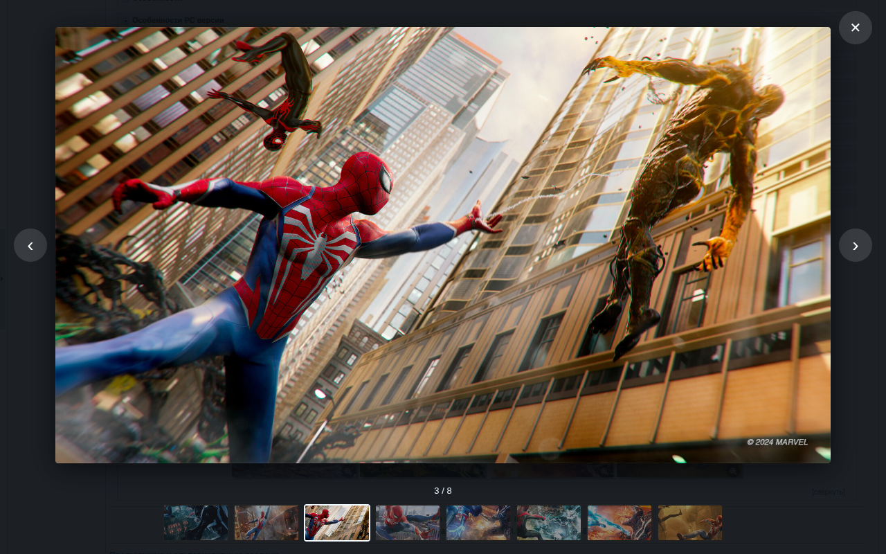

<h1 align="center">
  <br>
  RuTracker Games
</h1>

<p align="center">
  <a href="../../README.md">🇬🇧&nbsp;English</a> •
  <a href="README.uk.md">🇺🇦&nbsp;Українська</a> •
  <a href="README.ru.md">🇷🇺&nbsp;Русский</a> •
  <a href="README.de.md">🇩🇪&nbsp;Deutsch</a> •
  <a href="README.fr.md">🇫🇷&nbsp;Français</a> •
  <a href="README.es.md">🇪🇸&nbsp;Español</a> •
  <a href="README.it.md">🇮🇹&nbsp;Italiano</a> •
  <a href="README.pl.md">🇵🇱&nbsp;Polski</a> •
  <a href="README.pt.md">🇧🇷&nbsp;Português</a> •
  <a href="README.ja.md">🇯🇵&nbsp;日本語</a>
</p>

<h4 align="center">Скриншоты и полезные метки прямо в списке раздач игр на RuTracker — не нужно открывать каждую тему.</h4>

<p align="center">
  <a href="../../LICENSE"></a>
  <a href="../../CHANGELOG.md"></a>
  
  
  <a href="https://github.com/iArtem88/rutracker-games/actions/workflows/ci.yml"></a>
</p>

<p align="center">
  
</p>

---

## Содержание

- [Что умеет](#что-умеет)
- [Где работает](#где-работает)
- [Установка](#установка)
- [Как пользоваться](#как-пользоваться)
- [Метки подробнее](#метки-подробнее)
- [Свои метки и слова](#свои-метки-и-слова)
- [Приватность](#приватность)
- [Бережно к сайту](#бережно-к-сайту)
- [Частые вопросы](#частые-вопросы)
- [Помочь проекту](#помочь-проекту)
- [Разработка](#разработка)
- [Лицензия](#лицензия)

## Что умеет

Прямо в списке раздач, между названием и автором:

- **Скриншоты** из спойлера «Скриншоты» — те же миниатюры, что и в теме. Миниатюра с лупой открывается в полном размере в собственном просмотрщике расширения, прямо на странице и без рекламы хостинга: ← → или лента миниатюр снизу листают, Esc закрывает. Без лупы — просто картинка: на страницы хостингов расширение не ссылается. Показывается одна строка, кнопка «ещё N» раскрывает остальные.
- **В теме раздачи** спойлеры со скриншотами раскрываются сами (это можно выключить в настройках), а скриншоты открываются в том же просмотрщике.
- **Метки из описания раздачи:**
  -  — озвучка на вашем языке, в скобках уточнение: машинная, любительская, частичная, ставится модом;
  -  — игра на вашем языке, а озвучки в ней просто нет;
  -  — текст и субтитры на вашем языке, озвучка на другом;
  -  — нужен ли Switch разгон и хватит ли разгона Кефира;
  -  — на какой прошивке PS4 или PS5 пойдёт игра;
  -  — минимум оперативной памяти и видеокарта для ПК;
  -  — по системным требованиям игра должна пойти на Steam Deck, а  — официальная оценка Valve (включается в настройках).
- **Панель фильтров** над списком: «Озвучка на моих языках», «Есть мои языки», «Потянет моя Switch», «Пойдёт на моей прошивке», «Хватит ОЗУ моего ПК», «Пойдёт на Steam Deck» и ваши метки.
- **Ваши языки.** Метки озвучки и текста ставятся для языков, отмеченных в таблице «Мои языки»: английский, украинский, русский, немецкий, французский, испанский, итальянский, польский, португальский, японский. По умолчанию отмечены русский, украинский и язык интерфейса. Сам интерфейс расширения тоже есть на этих 10 языках.
- **Свои метки** по словам или регулярному выражению и **свои слова** для метки разгона Switch.

<p align="center">
  
</p>

## Где работает

В списках разделов, в результатах поиска и в темах раздач для разделов игр RuTracker:

| Раздел | Что показывает |
|---|---|
| Игры для консолей » Switch | скриншоты, языки, разгон (Кефир / 4IFIR) |
| Игры для консолей » PS4, PS5 | скриншоты, языки, нужная прошивка |
| Остальные консоли (PS1–PS3, PSP, Vita, Xbox, Wii, DS, Dreamcast…) | скриншоты, языки |
| Игры для Windows | скриншоты, языки, минимум ОЗУ и видеокарта, Steam Deck |
| Игры для Apple Macintosh, игры для Linux | скриншоты, языки |
| Игры для мобильных устройств (Android, Oculus Quest, Symbian, Windows Mobile) | скриншоты, языки |
| Дополнения: моды и русификаторы для Windows-игр, Train Simulator, авиасимуляторы | скриншоты, языки |

Фильмы, музыка и остальное в планы не входят намеренно: для них лучше сделать отдельные расширения, чтобы каждое оставалось простым. В остальных разделах форума расширение ничего не делает и никаких запросов не отправляет.

<p align="center">
  
  
</p>

## Установка

- **Chrome, Edge, Brave, Opera, Яндекс Браузер:** скачайте `rutracker-games-…-chrome-full.zip` со страницы [Releases](https://github.com/iArtem88/rutracker-games/releases) и распакуйте. Откройте `chrome://extensions`, включите «Режим разработчика» и нажмите «Загрузить распакованное расширение». Это полная версия; `…-chrome.zip` рядом — версия для Chrome Web Store, в ней защищённые скриншоты fastpic (файлы `_…`) остаются миниатюрами.
- **Firefox:** скачайте `rutracker-games-…-firefox.xpi` со страницы [Releases](https://github.com/iArtem88/rutracker-games/releases) и откройте его в Firefox (или перетащите в окно), затем нажмите «Добавить». Файл подписан Mozilla, расширение обновляется само.

## Как пользоваться

Ничего настраивать не нужно: откройте раздел игр, например [Switch](https://rutracker.org/forum/viewforum.php?f=1605), и всё уже работает.

- **Кнопка расширения** на панели браузера: включить или выключить расширение и его метки, выбрать размер скриншотов.
- **Все настройки** («Свои метки и все настройки» в этом окне или «⚙ Настройки» на панели фильтров): ваши языки, ваша Switch, прошивка PS, ОЗУ ПК, Steam Deck, свои метки и слова, кэш.
- **Наведите мышь на метку** — увидите строку раздачи, по которой она поставлена.
- **Внешний вид:** на одноимённой вкладке настроек меняются цвета текста, фона и рамки любой метки, в том числе своих. Изменения видны сразу, и в открытых вкладках RuTracker тоже.

<p align="center">
  
  
</p>

## Метки подробнее

### Озвучка

Например, «Русская озвучка», «Украинская озвучка». Берётся из строки «Озвучка:» или «Язык озвучки:» («русская, английская», «ENG+RUS»), а если там её нет — из текста раздачи («опциональная русская озвучка…», «Russian Voice Mod») и из названия («RUS (Voice Mod.)», «RUS sound»). Фразы вроде «русской озвучки не будет» метку не ставят.

### Текст

Например, «Русский текст». Ставится, если язык есть в строке «Язык интерфейса», а озвучки на нём нет:

- зелёная «(без озвучки)» — в игре нет озвучки, она полностью на вашем языке;
- жёлтая «(английская озвучка)» — текст и субтитры на вашем языке, а озвучка на языке в скобках;
- контурная без уточнения — раздача не говорит, есть ли озвучка.

### Фильтры по языку

«Есть мои языки» и «Озвучка на моих языках» — один выбор: нажали одну кнопку, вторая отжимается; нажали её же ещё раз — снова видно всё. Остальные фильтры складываются с ним.

| Раздача | Все (ничего не нажато) | Есть мои языки | Озвучка на моих языках |
|---|:-:|:-:|:-:|
| Русская озвучка | ✅ | ✅ | ✅ |
| Русский текст (без озвучки) | ✅ | ✅ | ✅ |
| Русский текст (английская озвучка) | ✅ | ✅ | ❌ |
| «Русский текст» — раздача не говорит про озвучку | ✅ | ✅ | ❌ |
| Ничего на русском | ✅ | ❌ | ❌ |

### Разгон Switch

Расширение ищет в описании, просит ли автор разогнать консоль и какие частоты указывает, и сравнивает их с тем, что даёт встроенный разгон Кефира:

| Ревизия | CPU | GPU | RAM |
|---|---|---|---|
| Mariko (V2, Lite, OLED) | 1963 МГц | 1267 МГц | 2131 МГц |
| Erista (V1) | 1785 МГц | 921 МГц | 1862 МГц |

Метка состоит из двух половин:

- **«Желателен» или «Обязателен»** — как пишет автор: «лучше», «рекомендуется», «желательно» или «обязательно», «нужен», «требуется». Если есть и то и другое («стоит обязательно разогнать»), значит обязателен.
- **Кефир или 4IFIR (Чифир)** — сколько автор просит. 4IFIR, если автор называет его прямо (но не «работает и без Чифира»), даёт частоты выше пределов Кефира или просит «максимальный» разгон (кроме «максимального разгона Кефира»). В остальных случаях — Кефир.

| Автор пишет | Метка |
|---|---|
| «Лучше всего использовать разгон консоли» | Желателен разгон: Кефир |
| «Лучше всего максимально разогнать консоль» | Желателен разгон: 4IFIR |
| «Обязательно нужен разгон» | Обязателен разгон: Кефир |
| «Обязательно нужен разгон, CPU 2397 МГц» | Обязателен разгон: 4IFIR |

«Обязателен» с заливкой, «Желателен» контурная. Укажите в настройках ревизию консоли и свой разгон: если раздаче нужно больше, на метке появится ⚠, а фильтр «Потянет моя Switch» её спрячет.

Откуда пределы: из исходников самого Кефира. Его `kefir.kip` поднимает частоты до CPU 2193 / GPU 1267 / RAM 2131 МГц на Mariko, а sys-clk без ручного `allow_unsafe_freq` держит CPU на безопасных 1963 (Mariko) и 1785 (Erista).

### Прошивка PS4 / PS5

Из строки «Минимальная версия прошивки». Учитываются бэкпорты («8.50 + BACKPORT [5.05…]» значит, что игра пойдёт с 5.05) и верхний предел («работает только до 11.60»). Укажите свою прошивку в настройках, и неподходящие раздачи получат ⚠.

### ПК: ОЗУ и видеокарта

Минимум оперативной памяти и первая видеокарта из системных требований; в подсказке видны все требования: ОС, процессор, видеокарта. Укажите в настройках, сколько ОЗУ у вашего ПК, и раздачи, которым нужно больше, получат ⚠.

**Сборники.** Если в раздаче несколько игр, у каждой свой спойлер со своими требованиями (антологии), метка показывает разброс и самую требовательную видеокарту, например «1–6 ГБ ОЗУ · до GTX 780», а в подсказке — требования каждой игры. Фильтры и оценка Steam Deck судят по самой тяжёлой игре.

### Steam Deck

Две оценки:

- **По системным требованиям** (включена по умолчанию): фиолетовая «Пойдёт на Steam Deck». Steam Deck по графике примерно как GTX 1050 Ti, но играет в 800p, поэтому тянет минимальные требования примерно до GTX 1060 / RX 580 и до 16 ГБ памяти. Процессор и совместимость с Proton не учитываются.
- **Официальная оценка Valve** (выключена по умолчанию; при включении браузер спросит разрешение на доступ к сайту Steam): «проверено» (работает полностью), «играбельно» (может понадобиться настройка), «не поддерживается». Игра находится по ссылке на Steam или SteamDB в раздаче, а если ссылки нет — по точному совпадению названия в Steam. Где есть оценка Valve, она главнее. Она относится к Steam-версии, а сборка из раздачи может отличаться. У сборников её нет.

## Свои метки и слова

**Свои метки.** В настройках добавьте слова, например `DLC|дополнения` или `кооператив`, или регулярное выражение между косыми чертами, например `/(лучше|рекомендуется|желательно).*разгон/`. Раздачи, в названии или описании которых они встречаются, получат вашу метку вашего цвета, и её можно вынести на панель фильтров. Несколько примеров уже есть, они выключены.

<p align="center">
  
</p>

**Свои слова для разгона Switch.** В настройках Switch блок «Свои слова для меток» показывает слова, по которым ставится метка разгона — про разгон, «Желателен», «Обязателен», «Не нужен», «Максимальный», названия 4IFIR и Кефира — и позволяет дописать свои. Они добавляются к встроенным и сразу применяются, в том числе к уже загруженным раздачам.

<p align="center">
  
</p>

## Приватность

- Нет рекламы, аналитики, аккаунтов и своих серверов.
- Расширение запрашивает только страницы самого RuTracker, как будто вы открыли тему сами, а картинки грузит с тех же хостингов, что и тема. Единственное исключение — оценка Steam Deck от Valve: если вы её включите, расширение спросит у Steam номер и оценку игры (без ваших куки и данных). В полной версии у картинок fastpic, которые хостинг отдаёт только через свою страницу, просмотрщик незаметно загружает эту страницу с выключенными скриптами и берёт с неё ссылку на картинку; версия из Chrome Web Store страницы fastpic не загружает. Для картинок с ImgBB и PostImages оно узнаёт адрес полной картинки с её страницы на хостинге (без ваших куки).
- Настройки и кэш описаний раздач хранятся только в вашем браузере.
- Код открыт, и проверить это может любой. Подробнее в [PRIVACY.md](../../PRIVACY.md).

## Бережно к сайту

- Загружаются только раздачи, до которых вы долистали, не больше 2 запросов одновременно и с паузами.
- Если сайт перегружен или ограничивает запросы (429, 5xx, 403 от Cloudflare), расширение замолкает на время, а потом продолжает.
- Описание раздачи загружается один раз и хранится месяц; заново — только если раздачу обновили (в списке сменились её название или размер). Обновления расширения кэш не сбрасывают: в нём лежит само описание, и оно просто разбирается заново.
- Включённый фильтр сразу проверяет всю страницу. Чтобы грузить только то, до чего вы долистали, выключите в настройках «Фильтр сразу проверяет всю страницу».

## Частые вопросы

**Серые прямоугольники вместо скриншотов.** Картинка грузится с хостинга (fastpic, imageban…), а он медленный или недоступен из вашей сети. Через 20 секунд такие заглушки исчезают.

**Метка не появилась или появилась зря.** Описания раздач пишут люди, и каждый по-своему. Наведите мышь на метку, чтобы увидеть, на что она опирается. Если ошибка, [создайте issue](https://github.com/iArtem88/rutracker-games/issues) со ссылкой на раздачу, и мы поправим разбор. Для разгона Switch можно сразу дописать свои слова.

**Почему нет фильмов?** Расширение про игры. Для другого контента лучше отдельное расширение: так каждое остаётся простым.

**Это официальное расширение?** Нет. Это независимый проект, он не связан с RuTracker.

## Помочь проекту

Нашли ошибку или хотите поддержку ещё одного раздела? Загляните в [CONTRIBUTING.md](../../CONTRIBUTING.md): новый раздел добавляется одним небольшим файлом.

## Разработка

```sh
npm install        # только для тестов и сборки, в расширение ничего не попадает
npm test           # тесты разбора описаний, в настоящем Chromium
npm run test:e2e   # расширение целиком в Google Chrome на поддельном RuTracker, около минуты
npm run build      # dist/rutracker-games-<версия>-chrome.zip и …-firefox.zip
```

Само расширение — обычный JavaScript без сборки: чтобы попробовать свои изменения, загрузите `src/` как распакованное расширение.

## Лицензия

Copyright © 2026 [iArtem88](https://github.com/iArtem88).

RuTracker Games — свободная программа под [GNU General Public License v3.0](../../LICENSE) или (по вашему выбору) любой более поздней версией: её можно использовать, изменять и распространять, но любая копия или доработка тоже должна оставаться открытой под GPL.

Это неофициальное расширение, оно не связано с RuTracker.
