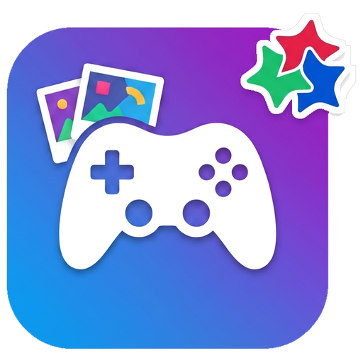
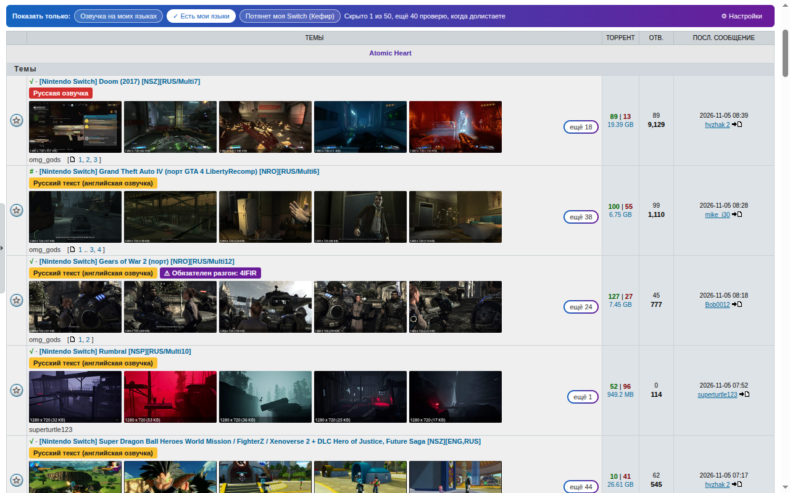
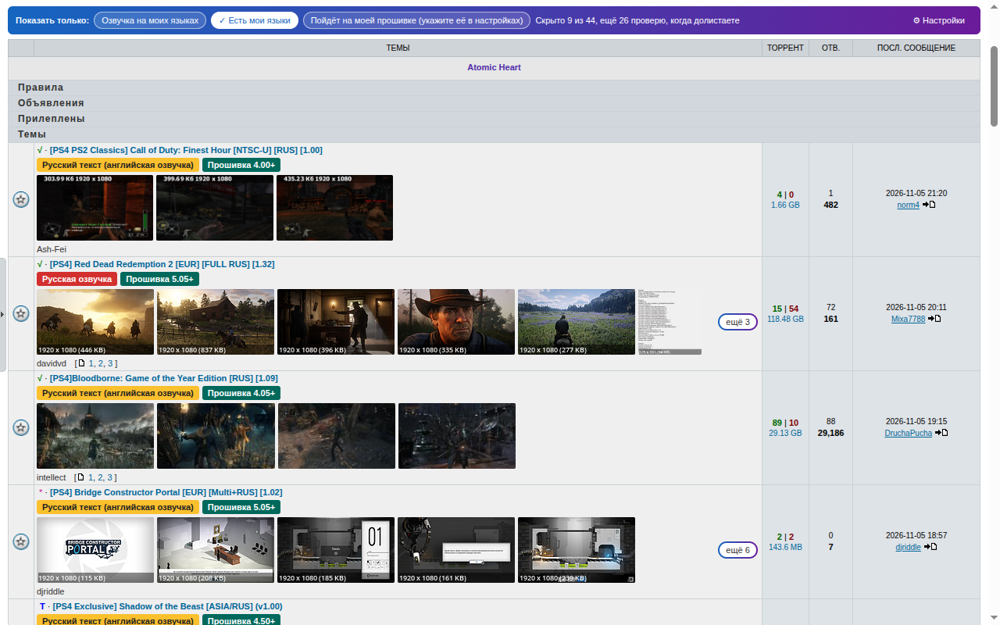
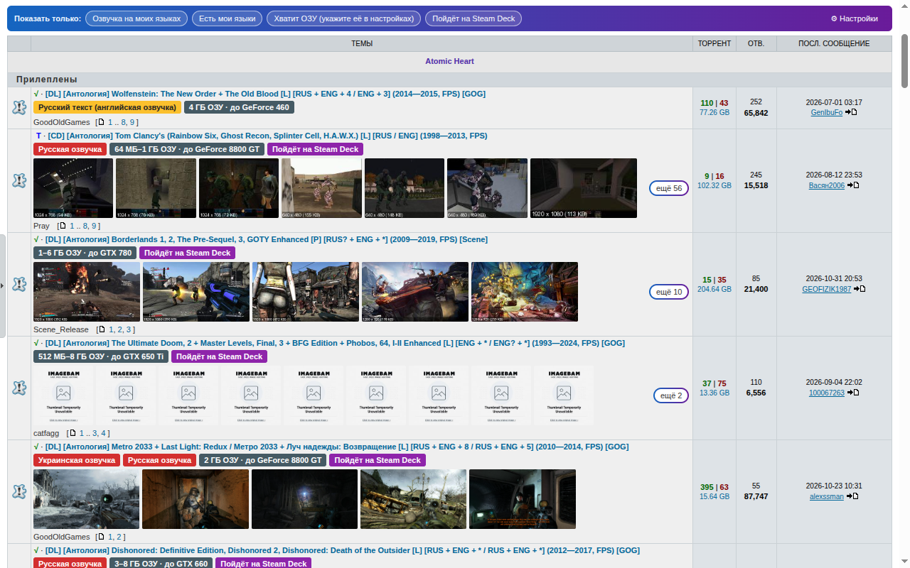
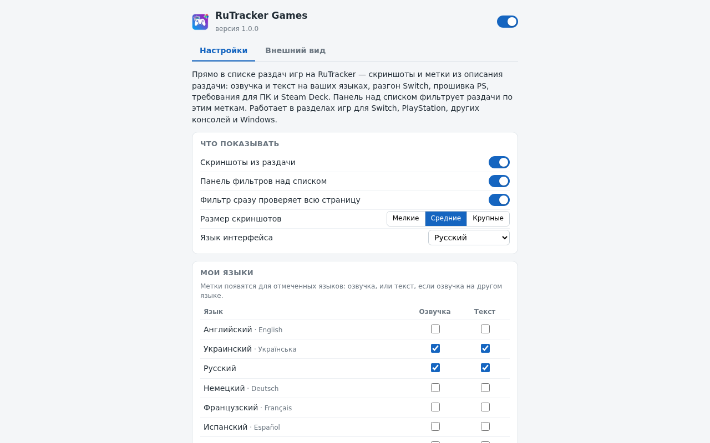
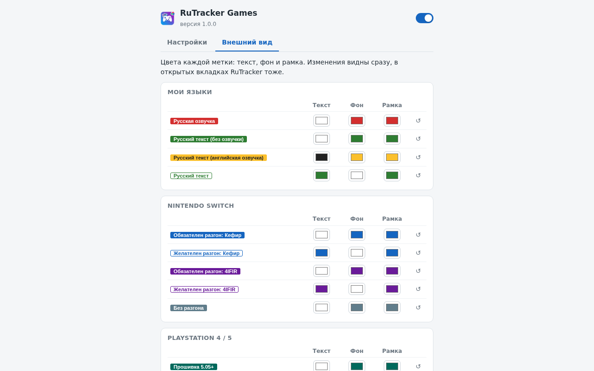
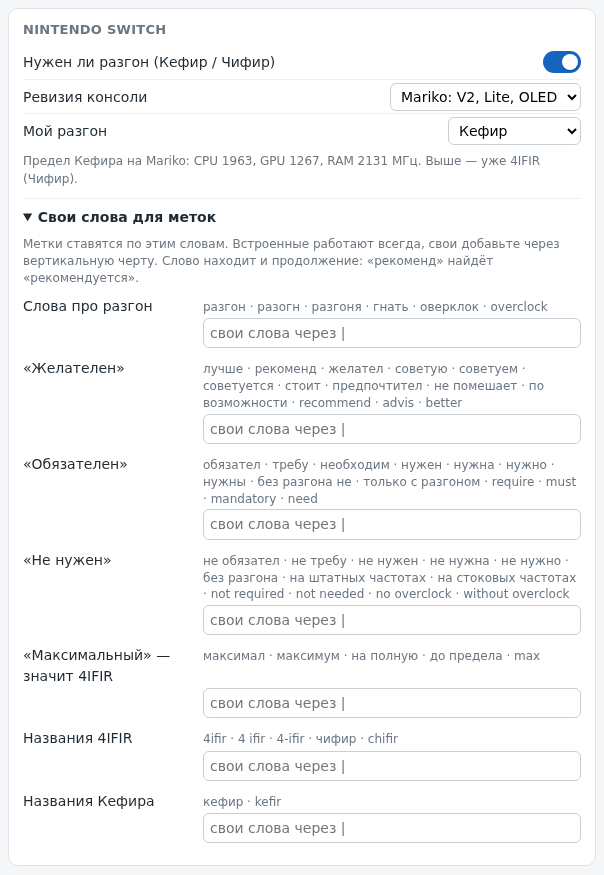

<h1 align="center">
  <br>
  RuTracker Games
</h1>

<p align="center">
  <a href="../../README.md">🇬🇧 English</a> •
  <a href="README.uk.md">🇺🇦 Українська</a> •
  <a href="README.ru.md">🇷🇺 Русский</a> •
  <a href="README.de.md">🇩🇪 Deutsch</a> •
  <a href="README.fr.md">🇫🇷 Français</a> •
  <a href="README.es.md">🇪🇸 Español</a> •
  <a href="README.it.md">🇮🇹 Italiano</a> •
  <a href="README.pl.md">🇵🇱 Polski</a> •
  <a href="README.pt.md">🇧🇷 Português</a> •
  <a href="README.ja.md">🇯🇵 日本語</a>
</p>

<h4 align="center">Скриншоти й зручні мітки просто в списках ігрових роздач RuTracker — без потреби відкривати кожну тему.</h4>

<p align="center">
  <a href="../../LICENSE"></a>
  <a href="../../CHANGELOG.md"></a>
  
  
  <a href="https://github.com/iArtem88/rutracker-games/actions/workflows/ci.yml"></a>
</p>

<p align="center">
  
</p>

---

## Зміст

- [Що вміє розширення](#що-вміє-розширення)
- [Підтримувані розділи](#підтримувані-розділи)
- [Встановлення](#встановлення)
- [Як користуватися](#як-користуватися)
- [Докладно про мітки](#докладно-про-мітки)
- [Власні мітки та слова](#власні-мітки-та-слова)
- [Приватність](#приватність)
- [Не перевантажує сайт](#не-перевантажує-сайт)
- [Часті запитання](#часті-запитання)
- [Як долучитися](#як-долучитися)
- [Розробка](#розробка)
- [Ліцензія](#ліцензія)

## Що вміє розширення

Просто в списку роздач, між назвою та автором:

- **Скриншоти** зі спойлера «Скриншоты» в роздачі: ті самі мініатюри, що й у темі, а клік відкриває повне зображення. Показано один ряд, решту розгортає кнопка «ще N».
- **Мітки з опису роздачі:**
  -  — озвучення вашою мовою, з подробицями в дужках: машинне, аматорське, часткове, мод;
  -  — гра вашою мовою, просто озвучення в ній немає;
  -  — текст і субтитри вашою мовою, а озвучення іншою;
  -  — чи треба розганяти Switch і чи вистачить власного розгону Кефіру;
  -  — прошивка PS4 / PS5, на якій гра запускається;
  -  — мінімальний обсяг ОЗП і відеокарта для ПК;
  -  — за системними вимогами гра має піти на Steam Deck, а  — це власна оцінка Valve (вмикається в налаштуваннях).
- **Панель фільтрів** над списком: «Озвучення моїми мовами», «Є мої мови», «Потягне моя Switch», «Піде на моїй прошивці», «Вистачить ОЗП мого ПК», «Піде на Steam Deck» і ваші власні мітки.
- **Ваші мови.** Мітки озвучення й тексту показуються для мов, позначених у розділі «Мої мови»: англійська, українська, російська, німецька, французька, іспанська, італійська, польська, португальська, японська. За замовчуванням позначено російську, українську та мову інтерфейсу. Інтерфейс розширення теж доступний цими 10 мовами.
- **Власні мітки** за словами або регулярним виразом і **свої слова** для мітки розгону Switch.

## Підтримувані розділи

Розширення працює в списках роздач і в результатах пошуку ігрових розділів RuTracker:

| Розділ | Що показує |
|---|---|
| Ігри для консолей » Switch | скриншоти, мови, розгін (Кефір / 4IFIR) |
| Ігри для консолей » PS4, PS5 | скриншоти, мови, потрібна прошивка |
| Інші консолі (PS1–PS3, PSP, Vita, Xbox, Wii, DS, Dreamcast…) | скриншоти, мови |
| Ігри для Windows | скриншоти, мови, мінімум ОЗП і відеокарта, Steam Deck |

Фільми, музику та все інше свідомо не охоплено: для них краще зробити окремі розширення, щоб кожне залишалося простим.

<p align="center">
  
  
</p>

## Встановлення

- **Chrome, Edge, Brave, Opera, Яндекс Браузер:** завантажте `rutracker-games-…-chrome.zip` зі сторінки [Releases](https://github.com/iArtem88/rutracker-games/releases) і розпакуйте архів. Відкрийте `chrome://extensions`, увімкніть «Режим розробника» й натисніть «Завантажити розпаковане розширення».

## Як користуватися

Нічого налаштовувати не треба: відкрийте ігровий розділ, наприклад [Switch](https://rutracker.org/forum/viewforum.php?f=1605), — і все вже працює.

- **Кнопка розширення** на панелі інструментів браузера вмикає й вимикає розширення та його мітки, а також задає розмір мініатюр.
- **Усі налаштування** («Власні мітки та всі налаштування» в цьому віконці або «⚙ Налаштування» на панелі фільтрів): ваші мови, ваша Switch, прошивка вашої PS, ОЗП вашого ПК, Steam Deck, власні мітки й слова, кеш.
- **Наведіть курсор на мітку**, щоб побачити рядок роздачі, на підставі якого її поставлено.
- **Вигляд:** однойменна вкладка задає колір тексту, фону й рамки кожної мітки, зокрема й ваших власних. Зміни видно одразу, і у відкритих вкладках RuTracker теж.

<p align="center">
  
  
</p>

## Докладно про мітки

### Озвучення

Наприклад, «Російське озвучення», «Українське озвучення». Мітка береться з рядка «Озвучка:» або «Язык озвучки:» («русская, английская», «ENG+RUS»); якщо його немає — з опису («опциональная русская озвучка…», «Russian Voice Mod») і назви роздачі («RUS (Voice Mod.)», «RUS sound»). Фрази на кшталт «русской озвучки не будет» мітки не ставлять.

### Текст

Наприклад, «Російський текст». Ставиться, коли мова є в рядку «Язык интерфейса», але озвучення цією мовою немає:

- зелена «(без озвучення)» — озвучення в грі немає, і вона повністю вашою мовою;
- жовта «(англійське озвучення)» — текст і субтитри вашою мовою, а озвучення — тією, що в дужках;
- контурна, без дужок — у роздачі не сказано, чи є озвучення.

### Розгін Switch

Розширення шукає, чи просить автор роздачі розігнати консоль і які частоти він указує, та порівнює їх із тим, що дає власний розгін Кефіру:

| Ревізія | CPU | GPU | RAM |
|---|---|---|---|
| Mariko (V2, Lite, OLED) | 1963 МГц | 1267 МГц | 2131 МГц |
| Erista (V1) | 1785 МГц | 921 МГц | 1862 МГц |

Мітка складається з двох частин:

- **«Бажаний» чи «Обов’язковий»** — як сформулював автор роздачі: «лучше», «рекомендуется», «желательно» або «обязательно», «нужен», «требуется». Якщо трапляється і те, і те («стоит обязательно разогнать»), розгін вважається обов’язковим.
- **Кефір чи 4IFIR («Чифир»)** — скільки саме просять. 4IFIR — якщо його названо прямо (але не «работает и без Чифира»), якщо вказано частоти, вищі за межі Кефіру, або якщо просять «максимальный» розгін (крім «максимальный разгон Кефира»). В усіх інших випадках — Кефір.

| Автор роздачі пише | Мітка |
|---|---|
| «Лучше всего использовать разгон консоли» | Бажаний розгін: Кефір |
| «Лучше всего максимально разогнать консоль» | Бажаний розгін: 4IFIR |
| «Обязательно нужен разгон» | Обов’язковий розгін: Кефір |
| «Обязательно нужен разгон, CPU 2397 МГц» | Обов’язковий розгін: 4IFIR |

«Обов’язковий» має суцільну заливку, «Бажаний» — лише рамку. Вкажіть у налаштуваннях ревізію та розгін своєї консолі: роздача, що вимагає більше, ніж може ваша, отримає ⚠, а фільтр «Потягне моя Switch» її сховає.

Звідки взялися межі: з вихідного коду самого Кефіру. Його `kefir.kip` піднімає частоти до CPU 2193 / GPU 1267 / RAM 2131 МГц на Mariko, а його sys-clk тримає CPU на безпечних 1963 (Mariko) і 1785 (Erista), якщо вручну не задати `allow_unsafe_freq`.

### Прошивка PS4 / PS5

Береться з рядка «Минимальная версия прошивки». Бекпорти враховуються («8.50 + BACKPORT [5.05…]» означає, що гра піде з 5.05), як і верхня межа («работает только до 11.60»). Вкажіть свою прошивку в налаштуваннях — і роздачі, які на ній не підуть, отримають ⚠.

### ПК: ОЗП і відеокарта

Мінімальний обсяг ОЗП і перша відеокарта із системних вимог; у підказці показано все: ОС, процесор, відеокарту. Вкажіть ОЗП свого ПК у налаштуваннях — і роздачі, яким потрібно більше, отримають ⚠.

**Збірки.** Коли в роздачі кілька ігор, кожна у власному спойлері зі своїми вимогами (антології), мітка показує діапазон і найвимогливішу відеокарту, наприклад «1–6 ГБ ОЗП · до GTX 780», а в підказці перелічено всі ігри. Фільтри й оцінка для Steam Deck орієнтуються на найважчу гру.

### Steam Deck

Дві оцінки:

- **За системними вимогами** (увімкнена за замовчуванням): фіолетова мітка «Піде на Steam Deck». За графікою Steam Deck приблизно на рівні GTX 1050 Ti, але грає в 800p, тож упорається з мінімальними вимогами приблизно до GTX 1060 / RX 580 і 16 ГБ ОЗП. Процесор і сумісність із Proton не враховуються.
- **Власна оцінка Valve** (вимкнена за замовчуванням; коли ви її вмикаєте, браузер просить доступ до сайту Steam): «перевірено» (працює повністю), «можна грати» (може знадобитися налаштування), «не підтримується». Гру знаходять за посиланням на Steam або SteamDB у роздачі, а якщо його немає — за точним збігом назви в Steam. Якщо оцінка Valve є, вона має пріоритет. Вона стосується версії зі Steam: версія в роздачі може відрізнятися. Збірки такої оцінки не отримують.

## Власні мітки та слова

**Власні мітки.** У налаштуваннях додайте слова на кшталт `DLC|дополнения` чи `кооператив` або регулярний вираз між косими рисками, наприклад `/(лучше|рекомендуется|желательно).*разгон/`. Роздачі, у назві чи описі яких знайдеться збіг, отримають вашу мітку вибраного кольору, а саму мітку можна винести на панель фільтрів. Кілька прикладів уже є в розширенні, але вони вимкнені.

**Свої слова для розгону Switch.** У налаштуваннях Switch розділ «Свої слова для міток» показує слова, за якими ставиться мітка розгону: про розгін, «Бажаний», «Обов’язковий», «Не потрібен», «Максимальний», назви 4IFIR і Кефіру, — і дає змогу додати свої. Вони доповнюють вбудовані й діють одразу, зокрема й для вже завантажених роздач.

<p align="center">
  
</p>

## Приватність

- Без реклами, аналітики, облікових записів і власних серверів.
- Розширення звертається лише до сторінок самого RuTracker — так, ніби ви відкрили тему самі, — і завантажує зображення з тих самих хостингів, що й тема. Єдиний виняток — оцінка Steam Deck від Valve: якщо її ввімкнути, розширення запитує в Steam ідентифікатор і оцінку гри (без ваших файлів cookie та даних).
- Налаштування й кеш описів роздач зберігаються у вашому браузері.
- Код відкритий, тож перевірити його може кожен. Докладніше — у [PRIVACY.md](../../PRIVACY.md).

## Не перевантажує сайт

- Розширення завантажує лише ті роздачі, до яких ви догортали, щонайбільше 2 запити одночасно й з паузами між ними.
- Коли сайт перевантажений або обмежує запити (429, 5xx, 403 від Cloudflare), розширення на певний час затихає, а потім продовжує роботу.
- Опис роздачі завантажується один раз і зберігається місяць; повторно — лише коли роздачу оновили (у списку змінилася її назва або розмір). Оновлення розширення не скидають кеш: у ньому зберігається сам опис, і його просто прочитують наново.
- Активний фільтр перевіряє всю сторінку одразу. Щоб завантажувати лише те, до чого ви догортали, вимкніть у налаштуваннях «Фільтр одразу перевіряє всю сторінку».

## Часті запитання

**Сірі прямокутники замість скриншотів.** Зображення береться з фотохостингу (fastpic, imageban…), який у вашій мережі працює повільно або заблокований. Такі заглушки зникають через 20 секунд.

**Мітки бракує або вона зайва.** Описи роздач пишуть люди, і кожен по-своєму. Наведіть курсор на мітку, щоб побачити, на чому вона ґрунтується. Якщо вона помилкова, [створіть issue](https://github.com/iArtem88/rutracker-games/issues) з посиланням на роздачу — і ми виправимо розбір. Для розгону Switch можна ще й одразу додати свої слова.

**Чому немає фільмів?** Це розширення — про ігри. Інший контент заслуговує на окреме розширення: так кожне лишається простим.

**Це офіційне розширення?** Ні. Це незалежний проєкт, не пов’язаний із RuTracker.

## Як долучитися

Знайшли помилку або хочете, щоб підтримувався ще один розділ? Загляньте в [CONTRIBUTING.md](../../CONTRIBUTING.md) (російською): новий розділ — це один невеликий файл, а issue можна писати будь-якою мовою.

## Розробка

```sh
npm install        # лише для тестів і збирання; у саме розширення з цього нічого не потрапляє
npm test           # тести розбору, у справжньому Chromium
npm run test:e2e   # усе розширення в Google Chrome на макеті RuTracker, приблизно хвилина
npm run build      # dist/rutracker-games-<version>-chrome.zip і …-firefox.zip
```

Саме розширення — це звичайний JavaScript без етапу збирання: щоб випробувати свої зміни, завантажте `src/` як розпаковане розширення.

## Ліцензія

Авторське право © 2026 [iArtem88](https://github.com/iArtem88).

RuTracker Games — вільне програмне забезпечення, що поширюється на умовах [GNU General Public License v3.0](../../LICENSE) або (на ваш вибір) будь-якої пізнішої версії: його можна використовувати, змінювати й передавати іншим, а будь-яка копія чи змінена версія теж має залишатися відкритою під GPL.

Це неофіційне розширення, не пов’язане з RuTracker.
